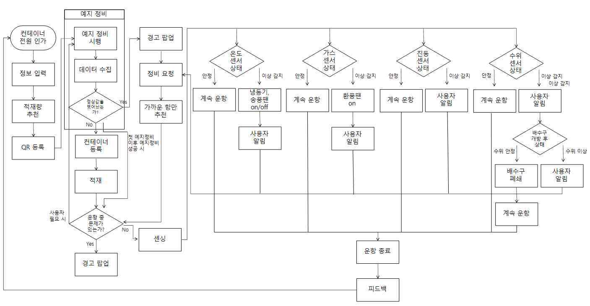

# 리퍼컨테이너 시스템 상세

[프로젝트 개요](README.md)

## 역할 분담

| 구성 | 책임 |
| --- | --- |
| ESP32 | 환경 및 상태 센서 수집, 서보모터와 배수 관련 액추에이터 제어 |
| Raspberry Pi | 냉각 및 환기 장치 제어, 서버와의 게이트웨이 |
| ESP32-CAM | 내부 영상 스트리밍 |
| AWS 서버와 DB | 운송 및 등록 정보 저장, 센서 데이터 전달과 AI 입력 연동 |
| MQTT | 측정값 및 제어 정보 전달 |
| Android 앱 | 등록, 환경 설정, 경고 확인, 위치 및 정비 안내 |
| Grafana | 센서 실시간 모니터링 |

## 데이터에서 대응까지

센서가 측정한 값은 장치와 서버를 거쳐 저장 및 표시됩니다. 품목 기반 환경 추천값은 다시 장치에 전달합니다. 센서의 임계치 초과, 급격한 변화 또는 응답 불능을 점검하고, 이상 종류에 맞는 장치 제어와 사용자 경고로 연결합니다.

## 이상 상황별 흐름

| 상황 | 설계된 대응 |
| --- | --- |
| 온도 이상 | 냉동기 및 송풍팬 제어, 사용자 알림 |
| 가스 또는 공기질 이상 | 환풍기 제어, 사용자 알림 |
| 진동 이상 | 사용자에게 상태 알림 |
| 수위 이상 | 배수구 개방, 수위 재확인, 이상 지속 시 알림 |
| 적재 전 점검 실패 | 적재 경고, 문제 센서 확인, 정비 요청 흐름 진입 |

위 표는 논문 도식의 서비스 흐름입니다. 모든 고장 유형을 실제 환경에서 검증했다는 의미는 아닙니다.

## 환경 추천과 상태 점검을 구분한 이유

환경 추천의 입력은 적재 품목과 운송 조건이며, 출력은 유지할 목표 환경입니다. 상태 점검의 입력은 실제 센서 반응이며, 출력은 정상 여부와 대응 정보입니다. 서로 다른 목표를 가진 기능이므로 같은 모델의 성능으로 묶어 평가하지 않습니다.

## 팀 협업과 통합

수행계획서에서 팀장은 프로젝트 관리, 백엔드와 AI 개발을 맡도록 정의되어 있습니다. 팀원들은 하드웨어 및 펌웨어, 앱 및 센서 제어, 3D 모델링과 AI 보조 개발로 역할을 나눴습니다. 개인 수행 사례로는 전체 연동과 통합 시험, MQTT Topic 불일치 해결을 정리했습니다.

통합 문제에서는 센서 → 서버 수신 → DB 저장 → 앱 구독의 순서로 확인해 정상 구간과 문제 구간을 분리했습니다. 이 과정에서 장치 식별자와 통신 규칙이 각 모듈에서 일치해야 한다는 점을 확인했습니다.
