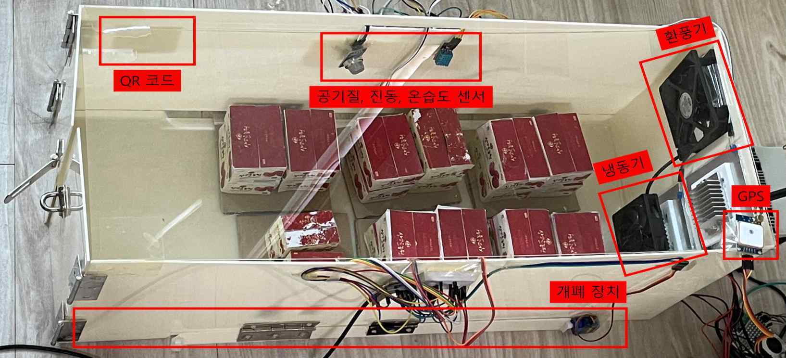
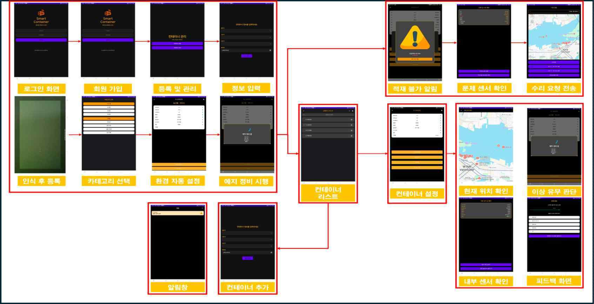
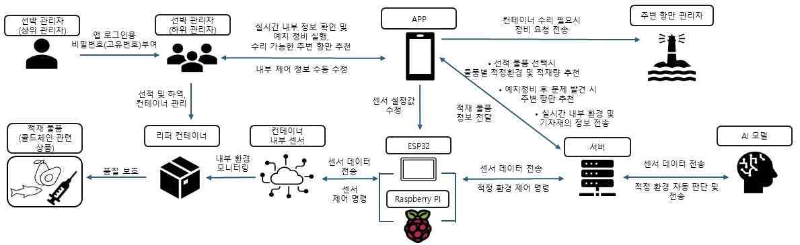

# 리퍼컨테이너 사진과 화면

[프로젝트 개요](README.md)

## 실제 제품 구성

논문 v5의 그림 4. 축소 프로토타입이며 상용 컨테이너 실선 운항 사진은 아닙니다.

## 모바일 화면

논문 v5의 그림 3. 회원가입, QR 등록, 환경 설정, 센서 경고와 정비 안내 화면을 연결합니다.

## 서비스 구성

논문 v5의 그림 1. 관리자, 앱, 제어보드, 서버와 AI의 관계를 보여줍니다.
